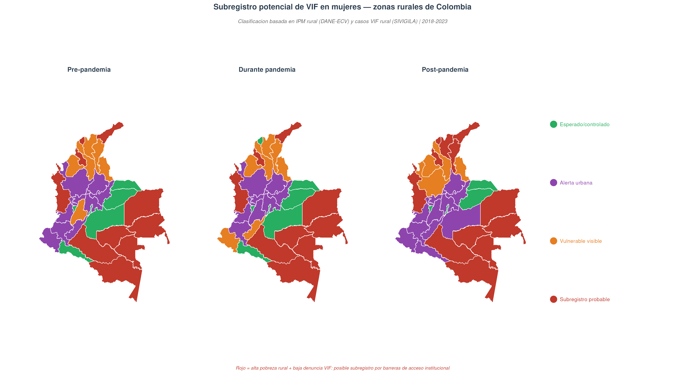
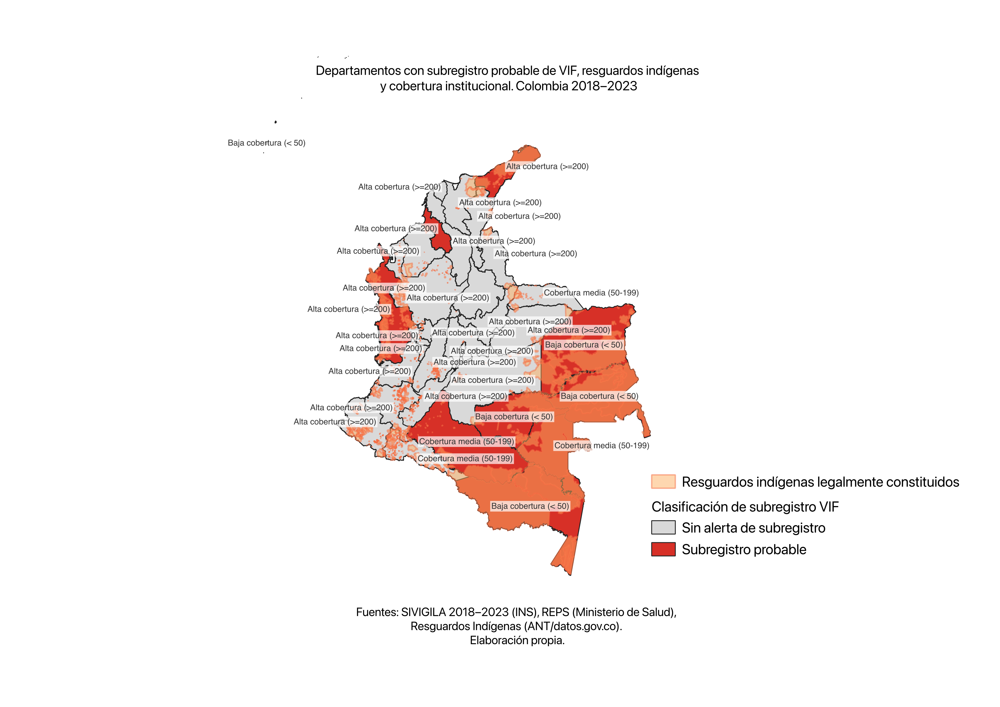
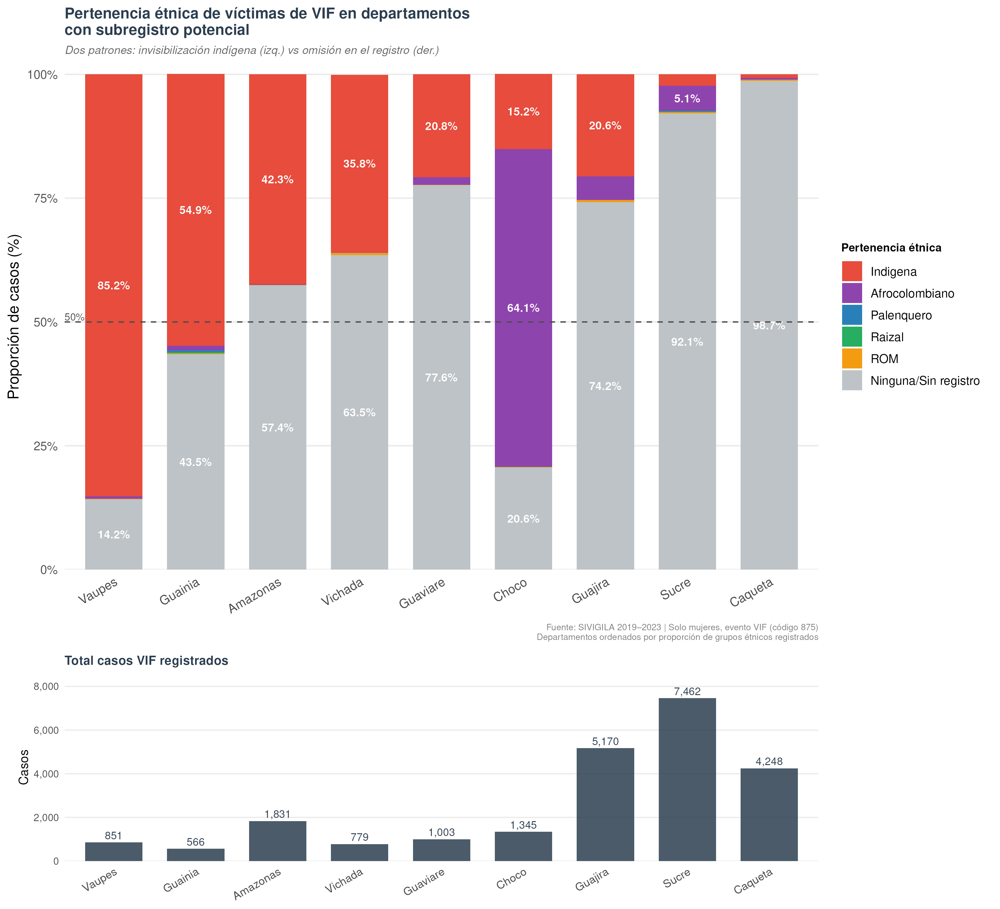

# Análisis interseccional de VIF en mujeres · Colombia 2018–2023


[](https://creativecommons.org/licenses/by/4.0/)
[](https://opensource.org/licenses/MIT)

> **Hallazgo central:** La correlación negativa entre el Índice de Pobreza Multidimensional y los casos reportados de VIF (rho = −0,555 a −0,645, p < 0,001) no refleja menos violencia real sino **subregistro estructural**: los territorios más pobres tienen menor capacidad institucional para registrar la violencia, no menos violencia.

---

## Descripción

Este repositorio contiene el análisis realizado como trabajo final del **Diplomado en Analítica y Modelamiento en Salud de las Mujeres (PSM-CO)**, desarrollado conjuntamente por la Pontificia Universidad Javeriana, el Instituto Nacional de Salud y la Universidad de Antioquia.

El estudio analiza los patrones de violencia intrafamiliar (VIF) contra las mujeres en Colombia durante 2018–2023, comparando los períodos pre-pandemia, pandemia y post-pandemia desde un enfoque interseccional que articula género, condiciones socioeconómicas y factores territoriales.

---

## Resultados principales

| Indicador | Valor |
|---|---|
| Total de casos analizados | 589.190 |
| Período | 2018–2023 |
| Unidad de análisis | 33 departamentos |
| Correlación IPM–VIF pre-pandemia | rho = −0,555 (p < 0,001) |
| Correlación IPM–VIF pandemia | rho = −0,601 (p < 0,001) |
| Correlación IPM–VIF post-pandemia | rho = −0,645 (p < 0,001) |
| Departamentos con subregistro probable | 9 |

### Tendencia temporal — patrón en V

Los casos descendieron un 13,1% en 2020 (confinamiento) para luego recuperarse hasta alcanzar 124.127 en 2023, la cifra más alta del período. La pandemia no redujo la violencia: inhibió su notificación.



### Subregistro potencial por departamento

Se identificaron 9 departamentos con alta pobreza rural y baja VIF rural reportada, clasificados mediante una matriz 2×2 usando las medianas nacionales como puntos de corte.



### Análisis cartográfico en QGIS

Mapa de capas múltiples elaborado en QGIS (v3.44, EPSG:3116) que integra
simultáneamente la clasificación de subregistro probable por departamento,
la distribución territorial de resguardos indígenas legalmente constituidos
y la cobertura de IPS por departamento.



Capas utilizadas:
- Shapefile departamental obtenido mediante `geodata::gadm("COL", level=1)` en R
- Resguardos indígenas legalmente constituidos (ANT · datos.gov.co)
- Cobertura IPS agregada por departamento desde REPS (MinSalud)

> Este mapa no se genera desde los scripts R. Requiere QGIS v3.44 o superior.

### Dos patrones de invisibilización étnica

El análisis de la variable PER_ETN en los 9 departamentos con subregistro probable reveló:

- **Invisibilización indígena:** Vaupés (85,2%), Guainía (54,9%), Amazonas (42,3%), Vichada (35,8%) — comunidades con sistemas propios de justicia que no reportan al SIVIGILA.
- **Omisión sistemática del dato étnico:** Caquetá (98,7%), Sucre (92,1%), La Guajira (74,2%), Guaviare (77,6%) — falla en la captura del dato en el punto de atención.



---

## Estructura del repositorio

```
vif-colombia-covid19/
│
├── README.md
├── scripts/
│   ├── 01_analisis_VIF_SIVIGILA.R       # Carga, limpieza y análisis descriptivo
│   ├── 02_limpiar_IPM_DANE.R            # Limpieza IPM + GEIH + cruce triple
│   ├── 03_mapas_bivariados.R            # Mapas IPM rural vs VIF rural
│   └── 04_mapa_subregistro.R           # Clasificación subregistro + etnicidad
├── outputs/
│   └── figuras/                         # Gráficos y mapas generados
└── .gitignore
```

---

## Fuentes de datos

Los datos **no están incluidos** en este repositorio por razones de licencia y tamaño. Son de acceso público y pueden descargarse desde:

| Fuente | Variable | URL |
|---|---|---|
| SIVIGILA – INS | Casos VIF (evento 875) | https://portalsivigila.ins.gov.co |
| DANE – ECV | Índice de Pobreza Multidimensional departamental | https://www.dane.gov.co/index.php/estadisticas-por-tema/pobreza-y-condiciones-de-vida/pobreza-multidimensional |
| DANE – GEIH | Tasa de desempleo femenino por departamento | https://www.dane.gov.co/index.php/estadisticas-por-tema/mercado-laboral/mercado-laboral-por-departamentos |
| MSPS – REPS | Cobertura IPS por departamento | https://prestadores.minsalud.gov.co/habilitacion/ |
| ANT – Datos Abiertos | Resguardos indígenas legalmente constituidos | https://www.datos.gov.co |

---

## Reproducibilidad

Ejecutar los scripts en este orden desde RStudio:

```r
# 1. Análisis descriptivo SIVIGILA
source("scripts/01_analisis_VIF_SIVIGILA.R")

# 2. Limpieza IPM + GEIH + correlaciones OE3
source("scripts/02_limpiar_IPM_DANE.R")

# 3. Mapas bivariados IPM rural vs VIF rural
source("scripts/03_mapas_bivariados.R")

# 4. Mapa de subregistro + análisis étnico
source("scripts/04_mapa_subregistro.R")
```

### Paquetes R requeridos

```r
install.packages(c(
  "tidyverse", "readxl", "readODS", "janitor", "stringi",
  "sf", "geodata", "biscale", "cowplot",
  "ggplot2", "ggrepel", "scales", "viridis", "writexl"
))
```

Para los mapas en QGIS (versión 3.44) se requiere descargar el shapefile de Colombia mediante `geodata::gadm("COL", level = 1)` desde R antes de abrir QGIS.

---

## Marco metodológico

- **Diseño:** Estudio ecológico-descriptivo con análisis de series de tiempo
- **Unidad de análisis:** 33 departamentos de Colombia
- **Períodos:** Pre-pandemia (2018–2019) · Pandemia (2020–2021) · Post-pandemia (2022–2023)
- **Enfoque teórico:** Interseccionalidad (Crenshaw, 1989) · Epidemiología de género · Modelo ecológico de Heise (1998)
- **Estadística:** Correlación de Spearman con aproximación normal para empates (exact = FALSE)
- **Cartografía:** Mapas bivariados con `biscale` en R + análisis de capas múltiples en QGIS (EPSG:3116)

---

## Consideraciones éticas

Análisis de fuentes secundarias de acceso público. Clasificado como **investigación sin riesgo** según Resolución 8430 de 1993 (MinSalud Colombia). Datos anonimizados. Ley 1581 de 2012 (protección de datos personales).

---

## Licencia

| Componente | Licencia |
|---|---|
| Documento, infografías y figuras | [CC BY 4.0](https://creativecommons.org/licenses/by/4.0/) — uso y adaptación libre con atribución |
| Código R | [MIT License](https://opensource.org/licenses/MIT) — reutilización libre citando la fuente |

Puedes usar, adaptar y redistribuir este trabajo — incluyendo con fines académicos o comerciales — siempre que cites la autoría original.

---

## Cómo citar este trabajo

```
Sayago Morales, A.Y. (2026). Análisis interseccional de violencia intrafamiliar
contra mujeres en Colombia 2018-2023: desigualdades de género, condiciones
socioeconómicas y factores territoriales en el contexto de la pandemia por COVID-19.
GitHub. https://github.com/tu_usuario/vif-colombia-covid19
```

> Si usas los scripts o las figuras en tu propio trabajo, por favor incluye esta referencia.

---

## Autoría

**Ana Sayago Morales**  
Trabajo final · Diplomado en Analítica y Modelamiento en Salud de las Mujeres · PSM-CO  
Pontificia Universidad Javeriana · Instituto Nacional de Salud · Universidad de Antioquia  
Colombia, marzo 2026

---

*Los datos son públicos. El análisis es reproducible. El subregistro es una decisión política, no un problema técnico.*